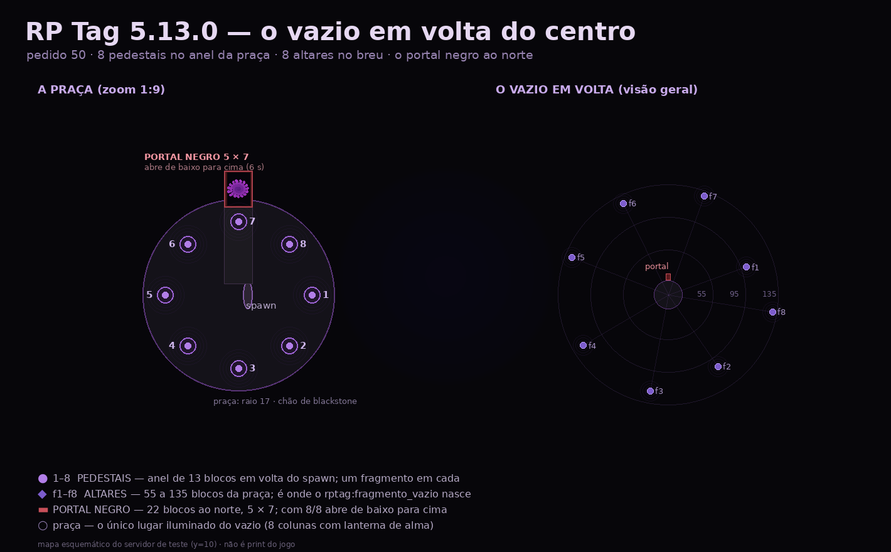

# RP Tag 5.13.0 — PEDIDO 50

**O arquivo para baixar:**
[rptag-5.13.0.jar](https://github.com/EduCafilista/rp-tag/releases/download/v5.13.0/rptag-5.13.0.jar)
· 69.348.751 bytes · `md5 f2d7e985ef2b1857d493b65b91b2433f`
· `sha256 55035d236569ef4505f728753fa5cf370f5cdb7189bdac586d405bbbf8fa0c25`

**Página da release:** https://github.com/EduCafilista/rp-tag/releases/tag/v5.13.0
(release `431944669`, asset `703106926`)

> **O cliente E o servidor precisam do jar novo.** O canal de rede subiu para **v13**
> (`vazio_portal`): cliente 5.12.0 num servidor 5.13.0 é recusado com aviso de versão (é de
> propósito — o portal do vazio precisa do lado dos dois).

---

## O que você pediu, e o que foi feito

| # | Seu pedido (50) | Como ficou |
|---|---|---|
| 1 | **Tablet um para cada jogador** | O **dono fica no item** (`TabletDono`/`TabletNome`). Soltar, dar ou perder o tablet não perde a ficha nem o dono. |
| 1b | pegar o de outro **vê a ficha do outro** | Abrindo o tablet de outra pessoa: topo **"Ficha de \<NOME\>"**, faixa vermelha **"TABLET DE OUTRA PESSOA — SÓ LEITURA"** e rodapé *"Você roubou este tablet…"*. É a lore do roubo. |
| 2 | **pedestais em volta do centro onde spawna** | **8 pedestais num anel de 13 blocos** em volta do spawn (antes: 210 a 470 blocos). O portal fica **22 blocos ao norte**, no fim de um caminho de laje. |
| 2b | **pôr os 8 fragmentos → abre o portal** | Cada pedestal **consome um `rptag:fragmento_vazio` da mão**. No 8º, o portal **abre sozinho**. |
| 3 | **portal do `KfElheRr.java`, abrindo de baixo para cima** | Moldura de obsidiana **7 × 9** (miolo **5 × 7**). A abertura preenche **uma linha de 5 blocos por vez, de baixo para cima, em 6 s**, com som de tom subindo. O vórtice é desenhado na paleta do protótipo (`#000000 → #5a1a74`) com brasas `#c0182c` e `#8a3fd0`. |
| 3b | **comando para invocar o portal** | `/vazio portal` **ergue o portal onde você está olhando** (6 blocos à frente) e abre se você tiver 8/8. `/vazio portal <jogador>`, `/vazio portal ir`, `/vazio abrir`, `/vazio fechar`, `/vazio construir`. |
| 4 | **sair devolve ao lugar de onde entrou** | Gravado **no save** (`RPWorldData.Volta`: dimensão + x/y/z + yaw/pitch) quando você é exilado. Nem restart do servidor faz você voltar num ponto sorteado. |
| 5 | **waystone proibida no vazio** | Bloco **e** item na mão são barrados em `rptag:exilio` (por id de registro: `waystone`, `warp_stone`, `portstone`, `warp_plate`, `sharestone`) com *"A pedra está morta aqui."* |
| 6 | **partículas desligadas não podem apagar os efeitos** | Portal, colunas de luz, anéis no chão e a **aura (manto) do Deus do Vazio** agora são **geometria no cliente** (`RenderLevelStageEvent` + `RenderType.debugQuads()`), não partícula do servidor. Funciona com Iris/Sodium e no jogo puro. |
| 7 | **o player precisa ver a aura em volta do vazio** | Manto novo: 12 nuvens de escuridão girando, 18 brasas violeta/sangue subindo e disco de névoa nos pés — **além** dos raios vermelhos que já existiam. |
| 8 | **a versão das releases é a base** | Tudo em cima da **5.12.0** (`9432166`), sem voltar nada. |



---

## O vazio, do jeito que está agora

```
                       PORTAL NEGRO (5×7, ao norte)
                                 ▮
                6              7 ▮ 8              1
                    ╲           │ │           ╱
                      ╲         │ │         ╱        anel de pedestais
                 5 ────  PRAÇA (spawn)  ──── 2      raio 13 · praça raio 17
                      ╱                   ╲
                4              3               ...  (8 no total)
```

- **Altares (f1–f8)**: 55 a 135 blocos da praça, cada um com coluna de luz, shrieker e o
  fragmento na tomada. Clique direito → o **item** vai para a mão (um altar por jogador).
- **Pedestais (1–8)**: clique direito **com o fragmento na mão** → encaixa, acende (sculk vira
  catalisador) e a coluna fica violeta. A barra de ação mostra **"Pedestais: n/8"**.
- **Portal**: com **8/8** ele abre sozinho; entre andando nele (0,7 s) ou clique. O miolo fecha
  atrás de quem passa e os pedestais apagam para o próximo.
- O vazio se constrói **sozinho**: praça, pedestais e portal de pé já na subida do servidor, e os 8
  altares entram **um a cada 5 s** — ninguém mais assiste o mundo se montando na frente dele.

---

## O que já foi testado no servidor (e como)

Servidor NeoForge 1.21.1 com o jar desta release, tudo por RCON:

```
summon item 0 100 0 {Item:{id:"rptag:fragmento_vazio"}}   → Summoned new Void Fragment
```

| Teste | Resultado |
|---|---|
| Praça nivelada | `praça do vazio nivelada em y=10` (log) |
| 8 pedestais no anel | `(13,0) (9,9) (0,13) (-9,9) (-13,0) (-9,-9) (0,-13) (9,-9)` — todos em y=10 |
| Base/coluna/tomada do pedestal | `polished_blackstone` / `obsidian` / `sculk` — conferidos bloco a bloco |
| Portal | pilar `crying_obsidian` em x=-3, verga `polished_blackstone` em y=17, **miolo de ar** |
| `/vazio abrir` (animação) | **t+2 s: linhas 0–1 · t+4 s: 0–3 · t+6 s: 0–6** — abertura de baixo para cima confirmada |
| `/vazio fechar` | miolo volta a ar nas 7 linhas |
| Altares | os 8 construídos (um a cada 5 s), com shrieker, pilar de obsidiana e lanterna de alma |
| Caminho até o portal | laje `polished_blackstone` e as 11 camadas de ar acima dele |
| `check.py` | **842 PASS / 0 FAIL** |

**O que só um jogador de verdade confirma** (eu não tenho como entrar com personagem aqui):
clique no altar pegando o item, clique no pedestal consumindo o fragmento, o portal abrindo no
8º, atravessar e cair no ponto de origem, a waystone barrada e o desenho do vórtice no cliente.

---

## Roteiro de teste para você (5 minutos)

1. Instale o `rptag-5.13.0.jar` no servidor **e** no cliente. Entre.
2. `/vazio entrar` — você cai na praça. Olhe em volta: **8 pedestais** no anel, colunas de luz,
   **portal a norte** (morto, com um vinco vermelho no meio).
3. `/vazio fragmentos` — ganha os 8 fragmentos na mochila.
4. Vá de pedestal em pedestal e **clique com o fragmento na mão**. A cada um: som, faísca e
   "FRAGMENTO ENCAIXADO n/8". No 8º, vire para o norte e **veja o portal acender de baixo para
   cima**.
5. **Entre no miolo andando** (ou clique nele). Você volta para **exatamente onde estava** quando
   `/vazio exilar` te pegou.
6. Teste a waystone: tente usar/colocar uma no vazio — *"A pedra está morta aqui."*
7. **Desligue as partículas** (Vídeo → Partículas: Mínimas) e volte ao vazio: o vórtice, as colunas
   dos pedestais e a aura do Deus do Vazio (`/vazio ligar`) **continuam aparecendo**.
8. `/vazio portal` (de dentro do vazio) — o portal é **invocado onde você está olhando**.

Se algo não bater, me diga o passo e o que apareceu na tela — eu corrijo na 5.13.1.

---

## Arquivos tocados

**Novos**: `FragmentoItem` · `VazioGeometria` · `VazioPortalPayload` · `client/VazioPortalFx`
· `assets/rptag/models/item/fragmento_vazio.json` · `assets/rptag/textures/item/fragmento_vazio.png`

**Reescritos**: `VazioReino` (todo o reino em volta do centro) · `NeptuneEventos` (chegada,
praça, volta pelo portal, `/vazio ir`)
**Ajustados**: `RPWorldData` (santuario/pedestal/volta/portal) · `ServerEvents` (waystone)
· `NeptuneCommands` (`/vazio portal|abrir|fechar|construir|pedestais`) · `RaiosVazioFx` (manto)
· `ModNetworking` + `ClientPayloadHandler` (canal v13) · `TabletItem/TabletService/TabletSyncPayload`
· `client/TabletScreen`/`TabletClientState` · `RPTagMod` (item) · lang pt_br/en_us
