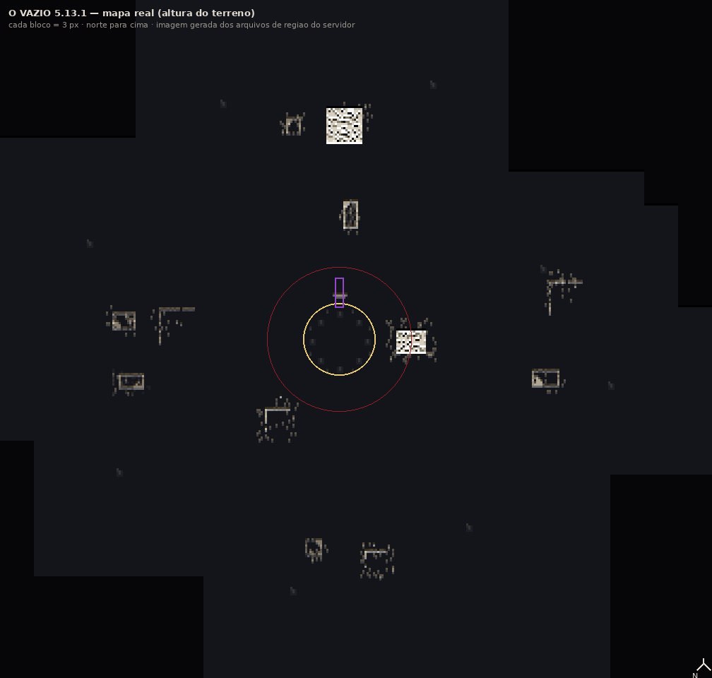

# RP Tag 5.13.1 — PEDIDO 51

**O arquivo para baixar:**
[rptag-5.13.1.jar](https://github.com/EduCafilista/rp-tag/releases/download/v5.13.1/rptag-5.13.1.jar)
· 69.352.583 bytes · `md5 39d279743e2c4b8790deb7f2898a9509`
· `sha256 6193278561e4cf1efe5ba0943ca3199eba6960f2785be9609d2641e80599ce67`

**Página da release:** https://github.com/EduCafilista/rp-tag/releases/tag/v5.13.1
(release `432013740`, asset `703310681`)

> **Troque o jar no servidor E no cliente.** O canal de rede continua o **v13** da 5.13.0
> (nada novo em pacote), mas **a aura, o rastro e a neblina são desenhados no cliente** — com o jar
> velho no cliente, o vazio aparece sem os raios e sem o rastro.

---

## O que você pediu, e o que foi feito

| # | Seu pedido (51) | Como ficou |
|---|---|---|
| 1 | **"tira as partículas cinzas do vazio ligar, as partículas pretas"** | Saíram **todas**: `SQUID_INK` (tinta preta), `LARGE_SMOKE` (fumaça cinza), `ASH`/`WHITE_ASH` e a poeira preta nos pés. Também saiu a poeira escura que caía no chão da dimensão inteira. |
| 1b | **"esses quadrados grandes ficaram esquisitos, melhore isso"** | O **manto** (12 nuvens desenhadas como quadrados virados para a câmera) foi **apagado do código**. No lugar entrou o **rastro** novo: rachaduras finas vermelho-sangue no chão, que esfriam até virar cinza-carvao e somem em 22 s (`client/RastroVazioFx`). |
| 2 | **"os raios vermelhos ficaram daoras, continue melhorando o rastro dele"** | Os **raios continuam** (agora sem nada em volta para sujar a leitura deles) e ganharam companhia: o corpo solta **estilhaços de pedra** (bloco de verdade, não fumaça) e o chão abre o rastro acima. Os **dois olhos vermelhos** continuam no rosto. |
| 3 | **"o vazio deve ser como antes, pq agora ta tudo preto na dimensao"** | `dimension_type/exilio.json` voltou **exatamente** aos valores de `9938159`: `ambient_light 0.42`, `has_skylight true`, `has_ceiling false`, céu do **overworld** às 6 h. A neblina do cliente saiu do quase-preto para um **cinza-azulado** com horizonte de **190 blocos** (era 96). |
| 4 | **"onde a pessoa entrar na dimensão, na hora que sair ele deve continuar no mesmo local que ele sumiu"** | A volta é gravada **no save** (`RPWorldData.Volta`: dimensão + x/y/z + yaw/pitch) no instante em que a pessoa entra — sobrevive a restart. O portal devolve **nas coordenadas exatas** e zera a marca depois (não dá para voltar duas vezes no mesmo ponto). A memória (`ORIGEM`) ficou só como rede de segurança. |
| 5 | **"invoquei o portal no overworld e ele não apareceu"** | **Duas causas, as duas corrigidas** (veja abaixo). Agora `/vazio portal <x> <y> <z>` no overworld **levanta a moldura e enche o miolo de baixo para cima**, mesmo num mundo **sem nenhum dos 8 fragmentos**. |
| 6 | **"a dimensão ter mais coisas, builda uns prédios, ruínas apagadas"** | A cidade morta **cresce sozinha**: uma **ruína a cada 3 s** em espiral em volta da praça (raio 34–104), em **3 tipos** — torre, ruína baixa e quarteirão. Paleta **apagada**: `deepslate_tiles`, `cracked_deepslate_bricks`, `tuff`, `gray_concrete`, `basalt` queimado, teto caído, 24–40 escombros por construção. |

---

## Por que o portal do overworld não aparecia (a causa raiz)

Eram **dois** bugs, um escondido atrás do outro:

1. **O relógio da abertura era GLOBAL.** `aberturaInicio`/`linhasColocadas` eram `static` e
   únicos: o portal do vazio já tinha gasto as 7 linhas da animação e o portal invocado depois
   ficava **com o miolo em ar para sempre**. Agora cada portal tem o seu relógio
   (`ABERTURA`/`LINHAS` por `chavePortal = dimensão + x,y,z`).
2. **O portal invocado dependia dos 8 fragmentos.** `animarAbertura`, `estadoPortal` e o próprio
   `usarPortal` só agiam com `isPortalAberto()` — que é o estado global do portal do vazio. No seu
   mundo **não há pedestal cheio**, então o portal do overworld nunca abria. Agora existe
   `aberto(nv, dados) = isPortalAberto() || portalInvocado(nv)`: **portal invocado é portal de
   teste, abre e é atravessável sem fragmento nenhum**.

---

## O vazio, do jeito que está agora

```
                    O QUE MUDOU NO VISUAL (5.13.1)
   luz .................................... 0,42 (era 0,0) — dá pra ver o chão
   céu .................................... overworld, 6 h (era o do End)
   neblina ................................ cinza-azulada, horizonte 190 (era 96, quase preto)
   aura (partícula) ....................... 2 olhos vermelhos + estilhaços de pedra
   aura (geometria no cliente) ............ raios vermelhos + rastro de rachaduras
   partículas cinzas/pretas ............... NENHUMA
   cidade ................................. ruínas nascendo sozinhas, 1 a cada 3 s
```



*Mapa **de verdade**, não desenho: cada ponto é a altura do terreno lida do save do servidor depois de
alguns minutos de jogo. Os retângulos claros são as ruínas (paredes em pé, miolo vazio). O anel
amarelo é a praça (raio 17), o círculo vermelho é o limite dos pedestais (raio 34 do anel de
ruínas) e o retângulo roxo é o **portal**, 22 blocos ao norte.*

```
                        A CIDADE MORTA (espiral de ouro em volta da praça)
                    ╱                                                ╲
              ▓▓▓              ░░░░░░          ▓▓                ▓▓▓▓
              ▓▓▓  torre       ░░░░░░ quarteirão▓▓   ruína baixa  ▓▓▓▓
              ▓▓▓  (raro)      ░░░░░░  (muro L) ▓▓   (teto no    ▓▓▓▓
                   ▒▒              ░░░░░░           canto)           ▒▒
              ───────────────  PRAÇA + 8 PEDESTAIS  ───────────────
                                 portal ao norte ▮
```

- **Torre** (2 em 10): 4×4 a 7×7, 12 a 22 blocos de altura, topo quebrado.
- **Ruína baixa** (5 em 10): 7×13, 5 a 12 de altura, parede faltando, telhado só num canto, 24 escombros.
- **Quarteirão** (3 em 10): muro em L de 8 a 17 blocos, 2 postes de basalto com lanterna (50%), 40 escombros.
- Nada é construído em cima da praça: o raio mínimo é `praça (17) + 8` blocos.

---

## O que já foi testado no servidor (e como)

Servidor NeoForge 1.21.1 com o jar desta release, tudo por RCON:

| Teste | Resultado |
|---|---|
| `/vazio portal 120 70 -60` no overworld | moldura em x=117/123 (y 69–76), verga em y=77, piso y=68 e **miolo `black_concrete` em 120 y=70..76** |
| O MESMO teste **sem os 8 fragmentos** (`/vazio fechar` antes) | `/vazio portal 400 70 -60` → **miolo cheio nas 7 linhas** (t+8 s). Era exatamente aqui que falhava |
| Portal do vazio `{0, 10..16, -22}` | miolo 5×6 cheio, e **fechado (ar) enquanto o portal global está fechado** |
| Dois portais abertos ao mesmo tempo | os três (vazio + 2 do overworld) cheios **sem um roubar as linhas do outro** |
| Persistência | restart do servidor → os portais invocados **reabrem sozinhos** de baixo para cima |
| Ruínas | conferidas em (−35,32), (5,−60), (−85,−15), (34,0): blocos sólidos acima de y=11 |
| Log do servidor | **zero exceptions** em todo o teste |
| `check.py` | **846 PASS / 0 FAIL** |

**O que só um jogador de verdade confirma** (eu não tenho como entrar com personagem aqui):
o desenho da aura e do rastro no cliente, o brilho do vazio com o shader ligado, o clique nos
pedestais e o teleporte de volta caindo no ponto exato.

---

## Roteiro de teste para você (4 minutos)

1. Troque o jar **no servidor e no cliente**. Entre.
2. **No overworld**, `/vazio portal` — o portal sobe na sua frente e **abre de baixo para cima**
   (sem precisar de fragmento nenhum; é portal de teste).
3. **Entre nele** → você cai na praça do vazio.
4. Olhe em volta: **dá para ver o chão** (não é mais breu total), o horizonte é cinza-azulado e,
   longe, aparecem **torres e muros apagados** — a cidade morta. Ande 40–80 blocos em qualquer
   direção para encontrar ruínas de perto.
5. `/vazio ligar` — a aura: **dois olhos vermelhos**, **raios** e **estilhaços de pedra**. Ande: o
   chão abre o **rastro** de rachaduras vermelhas atrás de você. **Nenhum quadrado e nenhuma
   fumaça cinza.**
6. Volte a pé até o portal do vazio (ao norte da praça) e **atravesse**. Você tem que aparecer
   **no exato lugar do overworld de onde você entrou no passo 3** — inclusive olhando para o mesmo lado.
7. Repita o 2–6 uma segunda vez, agora com **outro jogador** entrando por outro ponto: cada um volta
   no seu próprio ponto (a marca é por jogador, não global).

Se algo não bater, me diga o passo e o que apareceu na tela.

---

## Arquivos tocados

**Novos**: `client/RastroVazioFx` (rastro de rachaduras que esfriam)

**Reescritos**: `NeptuneEventos.auraVazio` (só olhos + estilhaços + pedrisco) · `tickManchas`
(sem tinta/fumaça) · `client/RaiosVazioFx` (manto removido) · `dimension_type/exilio.json`
(valores de `9938159`)

**Ajustados**: `VazioReino` (relógio por portal, `aberto()`, `ruinaAutomatica`,
`enfileirarRuinaBaixa`, `enfileirarQuarteirao`) · `client/VazioNeblina` (cinza-azulado, 190) ·
`check.py` (846 verificações) · `build.gradle` / `neoforge.mods.toml` / `RPTagMod` (5.13.1)
